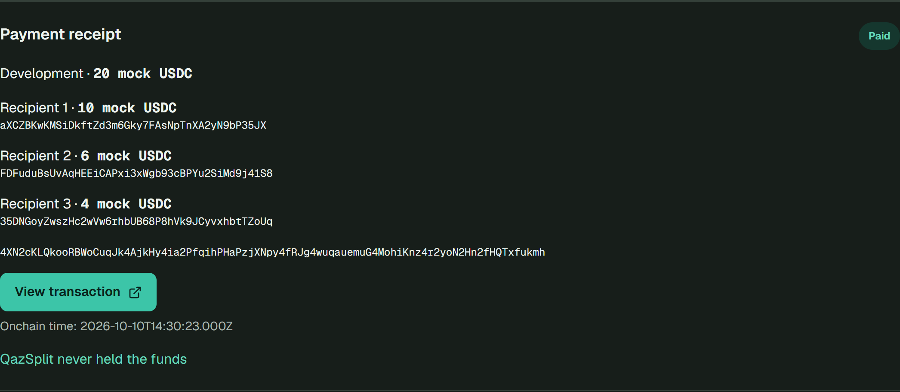
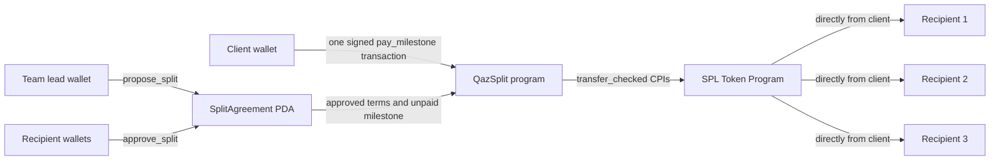

# QazSplit

> Agree on shares. Pay by milestone. Every teammate receives funds directly.

QazSplit lets a client pay a small project team in one atomic payment transaction. Every recipient first approves their share onchain. The client then pays a fixed milestone, and tokens go directly to the recipients, not through a QazSplit vault.

[Live app](https://qazsplit.vercel.app) · [Pitch video: 1:46](demo-day/QazSplit-pitch.mp4) · [App demo: 2:30, English](demo-day/QazSplit-demo-2m30-EN.mp4) · [12-slide pitch PDF](demo-day/pitch-deck.pdf) · [Try / verify the demo](docs/demo.md) · [Architecture](docs/architecture.md)

**Solana devnet only. Six-decimal mock USDC only. No real money. Unaudited hackathon prototype.**



*Actual devnet UI captured on October 10, 2026. This is an existing payment, not a new transaction being signed.*

## Problem and solution

A small team can agree on a 50/30/20 allocation, but a client paying one teammate still leaves that person responsible for forwarding everyone else's money.

QazSplit makes the allocation explicit before payment. Recipients sign their own shares. A client selects a milestone and signs one payment that distributes its exact amount according to those approved terms. The team can verify the receipt and reopen the payment in wallet history.

The intended audience is 2–5-person project teams already using Solana wallets. This is a workflow hypothesis backed by a working technical demo, not a claim of validated demand, customers or revenue.

## How it works

1. **Propose:** the team lead enters 2–5 unique wallets, positive shares totaling 10,000 basis points, and 1–5 named milestones with fixed amounts.
2. **Approve:** every recipient opens the same link and signs with their own wallet. At 2 of 3 approvals, payment is still blocked.
3. **Activate:** once all recipients approve, payments unlock. Terms have been fixed since proposal creation; there is no edit instruction.
4. **Pay:** the client chooses an unpaid milestone, simulates, then signs one atomic payment transaction.
5. **Verify:** check exact allocations, Paid status, recipient balances, receipt, wallet history and the devnet Explorer transaction.

Proposal creation and recipient approvals are separate transactions. "One signature" refers to each client's payment, not the whole setup process. Sending tokens to an arbitrary address does not trigger a split: the client must call QazSplit's payment instruction.

## Implemented features

| Feature | Current behavior |
|---|---|
| Recipient approval | Onchain wallet signatures; unauthorized and duplicate approvals rejected |
| Fixed allocation | Unique recipients, positive shares, exactly 100%; no term updates |
| Milestones | 1–5 fixed-amount stages using the same approved split; each payable once |
| Direct atomic payment | Payer-to-recipient Token Program transfers; any failure rolls back all payouts and payment state |
| Receipt | Milestone, exact amounts, full addresses, signature, Explorer link and timestamp when available |
| Wallet history | Reads agreements and confirmed payment activity from RPC; no application database |
| Wallet UX | Connection, devnet guard, allocation preview and simulation before signing |
| Legacy compatibility | Existing immutable `SplitConfig` accounts and payment URLs remain supported |

The focus is **recipient consent + milestone payments + direct settlement + verifiable receipts**, not payment splitting alone. We do not claim this combination is exclusive or a proven competitive moat.

## Why Solana

- **PDAs** store shared agreement terms, recipient approvals and milestone payment records onchain.
- **Wallet signatures** let the program verify each recipient's consent without application accounts or login.
- **Token Program CPIs** move tokens directly from the client to the recipients without custody.
- **Atomic transactions** commit all payouts and the Paid record together, or revert their state changes. Failed transactions can still charge fees. See [Solana's transaction model](https://solana.com/docs/core/transactions).

These properties make the agreement and settlement independently inspectable instead of trusting only a UI or spreadsheet. Other smart-contract chains can support similar patterns; this is an implementation choice, not a claim that atomicity is unique to Solana.

## Architecture



No vault, escrow, backend, database, login or indexer. The Next.js frontend reads and submits through Solana RPC. [State layouts, instructions and rounding](docs/architecture.md).

## Verified devnet example

| Item | Address / result |
|---|---|
| Program | [`3zqHQ8gWY2o8ZtfaGZg5JvgntkV6Qdf9zKBrJqufhKJD`](https://explorer.solana.com/address/3zqHQ8gWY2o8ZtfaGZg5JvgntkV6Qdf9zKBrJqufhKJD?cluster=devnet) |
| Mock USDC mint | [`7S3HyHeoD9WvVt63frsvRU9Kcixw2bRDAeyD8tVC6w8H`](https://explorer.solana.com/address/7S3HyHeoD9WvVt63frsvRU9Kcixw2bRDAeyD8tVC6w8H?cluster=devnet), 6 decimals |
| Approved agreement | [`A7MyBg1Ao9dSdXExBJxGop8mvjD2NuwGbDdeTj6WwGkU`](https://qazsplit.vercel.app/pay/A7MyBg1Ao9dSdXExBJxGop8mvjD2NuwGbDdeTj6WwGkU) |
| Development payment | 20 mock USDC; recipient deltas **+10 / +6 / +4** |
| Transaction | [Open finalized devnet payment in Explorer](https://explorer.solana.com/tx/4XN2cKLQkooRBWoCuqJk4AjkHy4ia2PfqihPHaPzjXNpy4fRJg4wuqauemuG4MohiKnz4r2yoN2Hn2fHQTxfukmh?cluster=devnet) |
| Evidence | Slot `509571296`, onchain time `2026-10-10T14:30:23Z`, one payer signature |

This milestone is already Paid and cannot be paid again. To reproduce a **new** payment, create a fresh agreement using wallets you control. Public demo addresses do not give access to the recipient wallets. [Step-by-step demo and funding requirements](docs/demo.md).

## Tech stack

| Layer | Technology |
|---|---|
| Onchain | Rust 1.89.0, Anchor 1.2.0, classic SPL Token Program |
| Frontend | Next.js 16.3.8, React 19.2.8, TypeScript, Tailwind CSS 4 |
| Wallet / RPC | Solana Kit 8, Wallet Standard, `@solana/react` |
| Tests | Anchor + Mocha integration suites; Vitest frontend suites |
| Toolchain | Node.js 24.x, npm 11.x, Solana CLI 4.2.2 |
| Hosting | Vercel frontend; Solana devnet program |

## Quick start

Run from the repository root with Node.js 24.x and npm 11.x:

```bash
git clone https://github.com/rahaxxc/qazsplit.git
cd qazsplit
npm ci
npm run dev
```

Open `http://localhost:3000`. The frontend already defaults to the deployed devnet program and mock mint. No `.env`, server credentials or deployer key is required to browse. Connect a devnet wallet only when you want to sign.

```bash
npm run lint
npm test
npm run build
npm run verify:fixture
```

The last command is a read-only live RPC check, not an offline test. For Anchor build/local integration tests, Windows WSL, clean-clone program loading, TypeScript checks and optional public environment settings, see [development instructions](docs/development.md).

## Tests and evidence

The recorded implementation verification on **October 10, 2026** passed **26 Anchor integration tests** and **109 frontend tests**, plus lint, TypeScript and production builds. These are dated results, not a guarantee that a future CI run is green. The program has not received an independent security audit.

Tests cover the 50/30/20 payout, incorrect totals, duplicate recipients, wrong mint, insufficient balance, exact rounding, atomic rollback, immutable terms, unauthorized/missing/duplicate approvals, payment gating and prevention of repeat milestone payments. History tests reject failed or unrelated payment evidence.

[Approval / milestone verification](reports/recipient-milestones-verification.md) · [History / release verification](reports/history-devnet-verification.md) · [CI runs](https://github.com/rahaxxc/qazsplit/actions)

## Repository map

```text
programs/qazsplit/src/   Anchor instructions, state and integer allocation math
tests/                  Legacy split and recipient-approved milestone integration tests
app/src/app/            Create Split, Approve / Pay Split and History routes
app/src/components/     Wallet, proposal, approval, payment and history UI
app/src/lib/            RPC clients, validation, decoding and exact token math
fixtures/               Public six-decimal devnet mock-mint fixture
scripts/                Fixture verifier and bounded maintainer devnet demo scripts
docs/                   Architecture, development, demo and roadmap
demo-day/               Video, 12-slide pitch, UI screenshots and presentation materials
reports/                Dated implementation and devnet verification records
.github/workflows/      Existing frontend and program CI
```

## Limitations and next validation

- Devnet test tokens only. No mainnet, real USDC or production-readiness claim.
- Fixed agreement terms do not mean an immutable deployment: the devnet program remains upgradeable.
- No escrow, delivery verification, disputes, guaranteed client payment or automatic recurring payroll.
- Every recipient must hold their own wallet and have devnet SOL for approval fees; the payer also needs this exact mock token.
- Wallet history depends on public RPC availability and retention. It is not a permanent archive service.
- A refresh/RPC error can appear beside an existing Paid receipt. Verify the matching transaction in Explorer before retrying; never pay a Paid milestone again.
- No customer demand, adoption or revenue claims are established. [Completed scope and next validation](docs/roadmap.md).

## Maintainer and contributions

Maintainer: [@rahaxxc](https://github.com/rahaxxc). Report reproducible issues through [GitHub Issues](https://github.com/rahaxxc/qazsplit/issues). See [CONTRIBUTING.md](CONTRIBUTING.md) for checks and scope boundaries. Do not post private keys, seed phrases or credentials.

## License

MIT. See [LICENSE](LICENSE). Dependency licenses remain their respective owners'.

