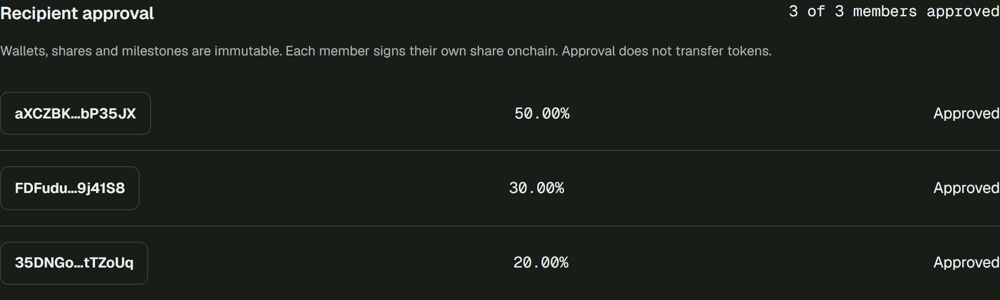

# Demo and judge walkthrough

**Solana devnet. Mock USDC only. No purchase of SOL or USDC is required. Never share a seed phrase or private key.**

## Start here

- [Live application](https://qazsplit.vercel.app)
- [Pitch video, 1 minute 45.76 seconds](../demo-day/QazSplit-pitch.mp4)
- [English narrated walkthrough, 2 minutes 30 seconds](../demo-day/QazSplit-demo-2m30-EN.mp4)
- [12-slide pitch PDF](../demo-day/pitch-deck.pdf)
- [Known approved agreement](https://qazsplit.vercel.app/pay/A7MyBg1Ao9dSdXExBJxGop8mvjD2NuwGbDdeTj6WwGkU)
- [Known Development payment in Solana Explorer](https://explorer.solana.com/tx/4XN2cKLQkooRBWoCuqJk4AjkHy4ia2PfqihPHaPzjXNpy4fRJg4wuqauemuG4MohiKnz4r2yoN2Hn2fHQTxfukmh?cluster=devnet)

Both MP4s are stored in this repository; if GitHub does not play them inline, use **View raw / Download raw file**. The **pitch video** is the supplied narrated slide presentation; the **app walkthrough** is a separate real-browser, read-only recording with English synthetic narration, not a newly signed payment. The app walkthrough shows a proposal preview, a separate Pending agreement and an existing approved agreement/receipt. No wallet secrets or new signatures were used to record that walkthrough.

## Verify existing proof without spending tokens

1. Open the known approved agreement. Check the three recipients and 50/30/20 shares; approval progress is 3 of 3.
2. Select **Development: 20 mock USDC**. It is already Paid. The receipt allocation is 10/6/4, not the recipients' total wallet balances.
3. Open the receipt's Explorer link. Ensure `cluster=devnet`, successful/finalized status, matching program and signature, and token balance deltas from the configured mock mint.
4. The payment was recorded at slot `509571296`, `2026-10-10T14:30:23Z`. Its signature is:

```text
4XN2cKLQkooRBWoCuqJk4AjkHy4ia2PfqihPHaPzjXNpy4fRJg4wuqauemuG4MohiKnz4r2yoN2Hn2fHQTxfukmh
```

Existing receipts are evidence of past settlement, not a promise that another transaction just happened. A Paid milestone cannot be replayed. Public devnet history can be unavailable or pruned; the dated reports and video preserve the verification context, not a replacement live chain.



## Reproduce a fresh end-to-end payment

Prepare **your own** 2–5 recipient wallets and a client wallet. Copying the public demo addresses does not let you approve their shares. Each recipient must control the corresponding wallet and sign personally; never import someone else's seed phrase or share yours.

1. In Phantom/Solflare, choose **Solana Devnet**, then connect to the app. Each signing wallet needs a small amount of faucet devnet SOL; the creator also pays agreement-account rent. Do not buy real SOL for this test.
2. Fund the client with the exact six-decimal mock mint: `7S3HyHeoD9WvVt63frsvRU9Kcixw2bRDAeyD8tVC6w8H`. Devnet SOL and mock USDC are different assets. An arbitrary token named USDC will not work. There is no public self-service mock-token faucet in this app: request test tokens from the maintainer using **only a public Solana address**, or run the local integration suite instead. Funding is not guaranteed to be available instantly.
3. **Create Split:** add your recipients at 50/30/20 and milestones Design: 10, Development: 20, Launch: 10 mock USDC. Simulate, then sign the proposal. Open its unique payment link; it starts Pending.
4. Open that same link with each actual recipient wallet. Click **Approve assigned share** and confirm. After each approval, refresh status as needed. At 2 of 3, payment remains blocked; at 3 of 3, it becomes Active / Locked. Approval moves no tokens.
5. Connect the funded client wallet. Select the new agreement's unpaid Development milestone. Preview 10/6/4, simulate, inspect the devnet wallet request and sign one payment transaction.
6. Confirm Paid, receipt and refreshed balances. Expected **changes** are payer −20 and recipients +10/+6/+4 mock USDC. Existing balances may be nonzero. Check the matching transaction in Explorer and reopen it through the connected wallet's History page.

Setup and recipient approvals are separate transactions; the payment alone is one client-signed transaction. No vault holds funds between stages. Delivery acceptance stays offchain.

## Recorded video timeline

| Time | Screen / evidence |
|---|---|
| 0:00–0:10 | Product introduction; devnet/mock-token boundary |
| 0:10–0:26 | Create Split preview with 50/30/20 recipients |
| 0:26–0:40 | Design 10, Development 20, Launch 10 milestones |
| 0:40–0:56 | Separate Pending agreement, 0/3 approvals |
| 0:56–1:14 | Existing approved agreement, 3/3 Active / Locked |
| 1:14–1:32 | Previously paid Development milestone, 20 → 10/6/4 |
| 1:32–1:52 | Matching historical receipt, signature and time |
| 1:52–2:10 | Wallet history and reopened payment evidence |
| 2:10–2:20 | Same finalized devnet transaction in Explorer |
| 2:20–2:30 | Closing / live app |

## If something fails

- **Approval disabled:** connect the configured recipient, not the creator/client unless that wallet is also a recipient.
- **Simulation fails:** check devnet, fee SOL, this exact mock mint, client token balance, all approvals and an unpaid milestone.
- **Wallet warning:** cancel and inspect the network and transaction; do not click an unsafe override to bypass an unexplained failure.
- **RPC/refresh error after signing:** check the existing signature/status in Explorer before any retry. A display error does not undo a confirmed payment.
- **RPC outage during presentation:** play the included MP4 and show the receipt screenshot, clearly labelled historical. Do not claim an offline screen proves a new payment succeeded.
